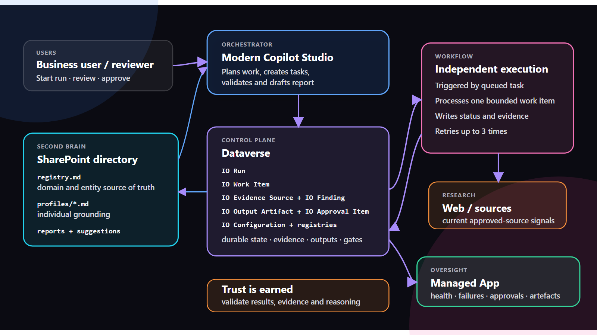

# Strategic Intelligence Operations Agent

I built Strategic Intelligence Operations as a reusable Microsoft Copilot Studio and Power Platform solution for governed research, monitoring, evidence-led reporting, review, and publication across competitor, media, market, regulatory, account, PMO, and risk domains.

The solution separates orchestration, evidence collection, synthesis, and approval so teams can adapt the same operating model to different intelligence jobs without hardcoding a customer, company, or report type.

## What is included

- A Copilot Studio agent with reusable instructions, knowledge, tools, and skills.
- Eleven Dataverse tables for configuration, registries, runs, work items, evidence, findings, outputs, and approvals.
- A native Copilot Studio `IO Process Work Item v3` Workflow with deterministic retries.
- A Power Apps Control Center for operational review and governance.
- Unpacked Power Platform source under `src/solution`.
- Deployment, configuration, demo, and troubleshooting guidance.

## Architecture

Dataverse acts as the operational control plane, SharePoint provides the human-readable second brain, and Copilot Studio coordinates bounded work items and governed synthesis.

## Current package

| Item | Value |
|---|---|
| Solution unique name | `StrategicIntelligenceOperations` |
| Package version | `1.0.0.8` |
| Package type | Unmanaged source plus managed/unmanaged release candidates |
| Unpacked source (`src/solution`) | `1.0.0.2`; refresh with `pac solution unpack` from the v1.0.0.8 unmanaged package |
| Publisher prefix | `cadpbm` |
| Maturity | Working |
| Source environment | Removed from repository content |

The source was exported from the selected Power Platform solution and then sanitized for reuse. The worker workflow is deliberately disabled in source control with the filter `cadpbm_workitemid eq '__CONFIGURE_BEFORE_ENABLE__'`. Configure connections, SharePoint, approvers, and sensitivity controls before enabling the production trigger.

## Repository layout

| Path | Purpose |
|---|---|
| `src/solution` | Unpacked Power Platform solution source |
| `docs` | Architecture, build, deployment, configuration, demo, and support guides |
| `architecture` | Editable and rendered architecture diagrams |
| `exports` | Local export staging; ZIP files are not committed |
| `dist` | Validated managed and unmanaged import packages |
| `media` | Screenshots and demo links |

## Downloadable packages

| Package | Use |
|---|---|
| [`strategic-intelligence-operations-managed-v1.0.0.8.zip`](dist/strategic-intelligence-operations-managed-v1.0.0.8.zip) | Recommended for controlled test, UAT, and production deployment |
| [`strategic-intelligence-operations-unmanaged-v1.0.0.8.zip`](dist/strategic-intelligence-operations-unmanaged-v1.0.0.8.zip) | Development, extension, and source-authoring environments |

Both packages are generated from sanitized source and ship with the worker trigger disabled until deployment configuration is complete.

## Start here

1. Read [Solution overview](docs/01-overview.md).
2. Review [Solution architecture](docs/02-solution-architecture.md).
3. Validate the [technical, licensing, and DLP prerequisites](docs/03-build-guide.md).
4. Follow the [Import and deployment guide](docs/05-import-deployment-guide.md).
5. Complete [Configuration](docs/06-configuration.md) before enabling automation.
6. Use the [demo script](docs/07-demo-script.md) for validation and storytelling.

## Operating guides

- [Approval notifications](docs/09-approval-notifications.md): Outlook email and Teams card for reports awaiting review.
- [Work item lifecycle](docs/10-work-item-lifecycle.md): statuses, retry rules, queueing safeguards and review load policy.
- [Agent skills and models](docs/11-agent-skills.md): skills, what changed after 1.0.0.2, and the models used.
- [Solution blueprint (HTML)](media/strategic-intelligence-operations-solution-blueprint.html): generic, self-contained overview. Open it in a browser.

## Safety model

- Evidence is captured before findings are synthesized.
- Outputs remain drafts until human approval.
- Persistent registry and profile changes require review.
- The reusable package contains no customer records, credentials, or environment-specific configuration.
- The asynchronous workflow ships disabled to prevent processing before deployment controls are set.

## Contact

Built and maintained by [Alicja Gilderdale](https://www.linkedin.com/in/alicja-gilderdale/).
