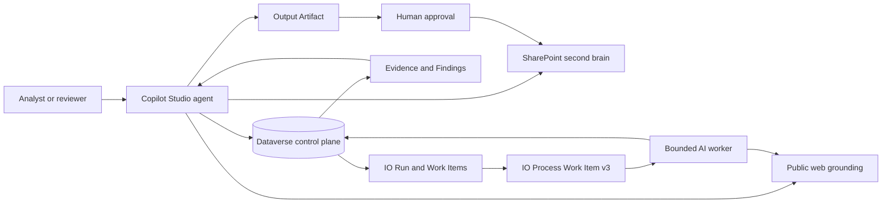

# Solution architecture

## Responsibilities

| Component | Responsibility |
|---|---|
| Copilot Studio agent | Setup, domain intake, queueing, monitoring, synthesis, and approval coordination |
| Dataverse | Durable operational state and audit trail |
| SharePoint | Human-readable profiles, templates, reports, and learned context |
| Worker workflow | Bounded research or extraction for one work item |
| Control Center | Run, queue, evidence, finding, output, and approval review |
| Public web grounding | Current public evidence with source URLs and retrieval dates |

The orchestrator does not perform per-entity report research directly. It creates work items and synthesizes only after worker results have reached terminal states.
