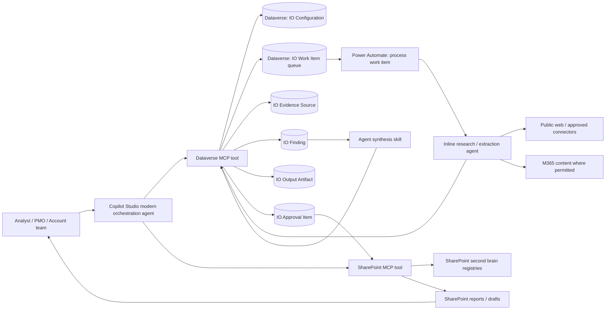

# Intelligence Operations Solution - architectural design

## Objective

Create a reusable intelligence operations agent that can collect, structure, review and publish recurring intelligence outputs across multiple domains without hardcoding the use case.

Initial supported domains:

1. Competitor intelligence
2. Market and customer intelligence
3. Regulatory and policy monitoring
4. Account and stakeholder intelligence
5. PMO governance drafting
6. Risk and incident briefing

## Reference architecture

## Core design decisions

| Decision | Rationale |
|---|---|
| Dataverse is the control plane | Supports robust queueing, status, retry, audit, approvals and analytics. |
| SharePoint is the second brain | Human readable, easy to govern, review and update. |
| Dataverse MCP is the operational tool | The agent uses the Microsoft Dataverse MCP Server to read/write configuration, queues, evidence, findings, outputs and approvals. |
| SharePoint MCP is the file tool | The agent uses SharePoint MCP to read/write second-brain registries, profiles, templates, drafts, reports, learned context and decisions. |
| Work is decomposed into bounded work items | Avoids long-running monolithic prompts and enables retry/remediation. |
| Registries drive behaviour | Domains, entities, sources and templates are configured rather than hardcoded. |
| Human approval is mandatory for outbound or persistent updates | Prevents silent publication and protects sensitive context. |
| Inline worker does not write to SharePoint directly | Worker writes structured evidence/findings to Dataverse; orchestrator publishes reviewed outputs. |

## Runtime pattern

1. User asks for an intelligence output, e.g. weekly competitor brief or PMO status report.
2. Agent reads IO Configuration through Dataverse MCP and SharePoint registries through SharePoint MCP.
3. Agent creates an IO Run and one or more IO Work Items through Dataverse MCP.
4. Workflow processes each work item through an inline worker.
5. Inline worker writes evidence and findings to Dataverse.
6. Workflow checks whether all work items are terminal.
7. Agent synthesises output using templates and citations.
8. Agent creates IO Output Artifact and IO Approval Items through Dataverse MCP.
9. User reviews/approves.
10. Approved output is published to SharePoint Drafts/Reports through SharePoint MCP and learned context is updated after approval.

## Storage model

Recommended default:

- Dataverse: operational records and queue state.
- SharePoint: second-brain files and generated review packs.
- Optional Azure Blob: large raw extracts, attachments or historical archives when files exceed SharePoint/Copilot limits.

Use SharePoint first for transparency. Add Blob only when large volume, retention, or file-size needs justify it.

## Active tool layer

The deployed agent has two active MCP-backed tools:

| Tool | Purpose |
|---|---|
| Microsoft Dataverse MCP Server | Operational control-plane access for all Intelligence Operations Dataverse tables. |
| SharePoint MCP | SharePoint second-brain file access for registries, profiles, templates, reports, learned context and decisions. |

See `tooling_design.md` for detailed tool responsibilities, connection references and skill-to-tool mapping.

## Pre-run competitor discovery

For Competitor domains, scheduled runs include a non-blocking pre-run discovery stage. The orchestrator creates a `Competitor Discovery` IO Work Item, but does not execute the research itself. The workflow/worker uses Search all websites and the domain context profile to identify possible new or adjacent competitors not already in the active entity registry.

Candidate competitors are written as `IO Finding` rows with Finding Type = `Candidate Entity` and as `IO Approval Item` rows with Approval Type = `AddEntity`. The weekly report continues using only currently approved Active entities. Approved candidates join future runs unless the user explicitly re-queues the current run.
